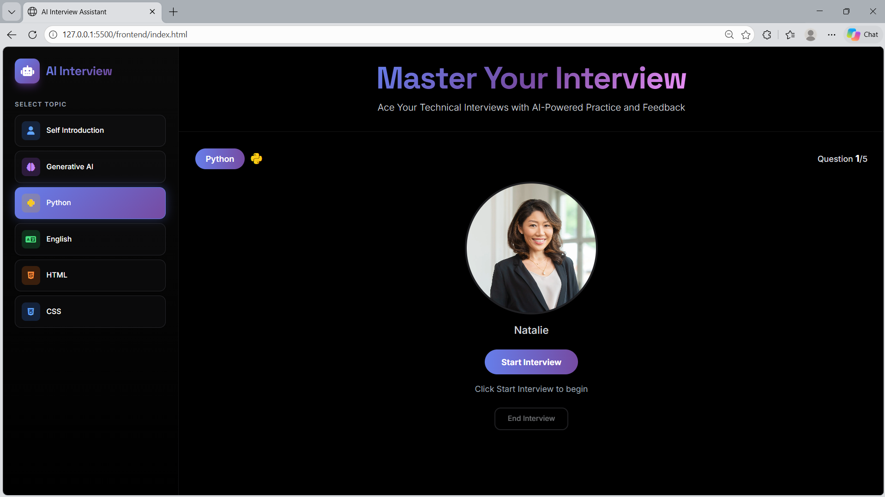

# 🎙️ AI-Powered Mock Interview Assistant

An AI-powered voice-based mock interview application that helps users practice interviews, improve their communication, and evaluate their technical knowledge through interactive AI-driven conversations.

## 📸 Application Screenshot



## ✨ Features

- **AI-Powered Interviews:** Generates subject-specific interview questions using Google Gemini.
- **Voice-Based Interaction:** Answer interview questions using your microphone.
- **Speech-to-Text:** Converts spoken answers into text using AssemblyAI.
- **AI Voice Responses:** Delivers interviewer responses using Murf AI.
- **Multiple Interview Topics:** Practice Python, Generative AI, English, HTML, CSS, and Self Introduction.
- **Performance Feedback:** Provides an AI-generated summary and feedback after the interview.

## 🛠️ Tech Stack

| Category | Technologies |
|---|---|
| AI Model | Google Gemini |
| AI Framework | LangChain, LangGraph |
| Backend | Python, Flask |
| Frontend | HTML, CSS, JavaScript |
| Speech-to-Text | AssemblyAI |
| Text-to-Speech | Murf AI |
| API Communication | REST APIs |

## 🏗️ Project Structure

```text
AI-INTERVIEW-ASSISTANCE/
│
├── backend/
│   ├── app.py
│   └── .env
│
├── frontend/
│   ├── index.html
│   └── index.js
│
├── SCREENSHOTS/
│   └── OUTPUT1.png
│
└── README.md
```

## ⚙️ Installation and Setup

### 1. Clone the repository

```bash
git clone https://github.com/DEVIAAKASH007/AI-INTERVIEW-ASSISTANCE-.git
cd AI-INTERVIEW-ASSISTANCE-
```

### 2. Install dependencies

```bash
pip install flask flask-cors python-dotenv langchain langgraph langchain-google-genai requests assemblyai
```

### 3. Configure API keys

Create a `.env` file inside the `backend` folder:

```env
GEMINI_API_KEY=your_gemini_api_key
MURF_API_KEY=your_murf_api_key
ASSEMBLYAI_API_KEY=your_assemblyai_api_key
```

### 4. Run the backend

```bash
cd backend
python app.py
```

### 5. Launch the frontend

Open `frontend/index.html` in your browser, preferably using the VS Code Live Server extension.

## 🔄 Application Workflow

1. Select an interview topic.
2. Start the mock interview.
3. Receive AI-generated questions.
4. Record and submit your answers.
5. Convert voice responses into text.
6. Receive AI-generated voice responses.
7. Review your interview feedback.

## 🔐 Security

- Store API keys in environment variables.
- Never commit `.env` files or expose API credentials.
- Keep private interview recordings and personal data out of the repository.

## 👨‍💻 Author

**Kondapalli Aakash**

[GitHub](https://github.com/DEVIAAKASH007)

---

⭐ If you find this project interesting, consider giving the repository a star!